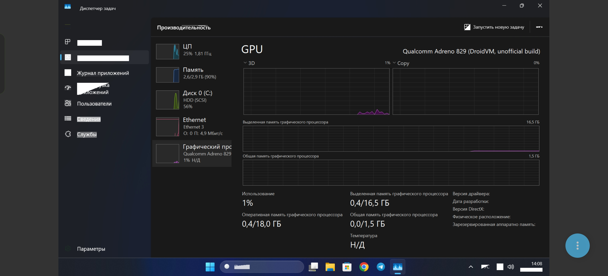

# droidvm-gpu-build

**English** | [Русский](README.ru.md)

An **unofficial** automated build of the VirtIO-GPU display driver for
**Windows 11 ARM64** running in the [DroidVM](https://github.com/Droid-VM)
virtual machine (tested on Snapdragon 8 Gen 5 / Adreno 829).

> ⚠️ This is **not** an official release. The driver was written by **anonymix007**
> and the **DroidVM team**; this repository only builds their open-source code
> with GitHub Actions and packages it into an installer. Build/packaging bugs
> belong to this repository, not to the driver authors. Please do not file bug
> reports about this build with the authors.
>
> Free of charge, **not for sale**. No warranty of any kind.

## Status (November 3, 2026, build-42)

The build is tuned for one specific setup: **DroidVM (dev 3348830) on
Snapdragon 8 Gen 5 / Adreno 829, Windows 11 ARM64**, tested in DroidVM on a
real device.



*Task Manager in Windows 11 ARM64 under DroidVM: GPU is Qualcomm Adreno 829, build-37.*

**Works (verified on the device):**
- hardware-accelerated desktop: `dwm.exe` renders through our DirectX 11
  driver → DXVK → Vulkan (Turnip) → the phone's Adreno 829 GPU;
- DirectX 11 / 10 applications, feature level **D3D 11_1** (dxdiag: 11_1 … 9_1);
- Chrome / Edge on the GPU, YouTube 4K video plays almost without lag;
- Windows 11 transparency and effects, Task Manager sees the GPU (3D load, VRAM);
- touch input at 1920x1080 in DroidVM.

**Known issues:**
- artifacts in Windows' own UI elements: white rectangles instead of some
  system text and garbage on classic window frames (browsers, video and DirectX
  apps render cleanly). Turnip optimizations, ClearType, shadows, MPO, timeouts,
  256-byte row pitch and uncached memory mapping are already ruled out;
  investigation continues (details in [docs/STATUS.md](docs/STATUS.md));
- **DirectX 12 device creation fails** (`vkd3d_create_device failed`), DX12 games do not run yet;
- **DirectX 9**: no dedicated driver, such apps fall back to software (WARP);
- **no OpenGL** yet, planned via Mesa Zink (OpenGL on top of our Vulkan);
- Vulkan applications have not been tested directly yet.

### Changes on top of the authors' sources (for DroidVM dev)
- `vulkan_freedreno.dll` is linked statically (otherwise it failed to load: libz/libwinpthread);
- the kernel driver reads the GPU memory pool address from the registry: crosvm in
  DroidVM dev does not report it (feature `DROIDVM_BOOT_POOL`); the INF default is for a **3 GB** VM;
- Turnip recognizes Adreno 829 by the ID `0x44030a00` reported by the host;
- a custom host `libvirglrenderer.so` (releases `host-N`) fixes a memory-binding error (EINVAL);
- the **DroidVM GPU** app (below) and automatic log collection.

## Required DroidVM settings
- Graphics: Renderer **VirGL**, Graphics API **Native Context**, Host driver **DRM to KGSL**,
  Virtio-GPU → **Enable display device** on, resolution **1920x1080**;
- Protected VM: **Pseudo Unprotected**; VM memory **5 GB or more** is recommended
  (3 GB is not enough for Windows). The GPU pool sits at the end of VM memory, so when
  you change memory or "Command buffer pool size", first set the same values in the app
  ("System" → "Apply"), otherwise you get a black screen;
- emergency exit: turn off Enable display device and Windows boots without the driver.

## DroidVM GPU app
`DroidVM-GPU.exe` (release `app-latest`): driver and GPU status, load,
log upload, Turnip fix toggles, installing new driver builds. It updates itself
(checks every minute) and notifies about new driver builds; the driver is
installed only when you press the button.

## Download

See [Releases](../../releases):

| File | Description |
|---|---|
| `DroidVM-GPU-Setup.exe` | installer: installs the test certificate and the driver, offers a reboot |
| `DroidVM-GPU-Uninstall.exe` | rollback: removes the driver and certificate, turns TESTSIGNING off (if the installer enabled it) |
| `DroidVM-GPU-driver.zip` | the same package for manual installation with `pnputil` |
| `SHA256SUMS.txt` | checksums |

## Installation

1. **Clone (copy) the VM disk.** The kernel driver is experimental; if Windows
   fails to boot, restoring the copy is the easiest way back.
2. In DroidVM, enable the Hugepage reserve (~3 GB) before starting Windows.
3. Inside Windows, run `DroidVM-GPU-Setup.exe` as administrator. It:
   - creates a restore point (if System Protection is enabled);
   - imports the certificate `DroidVM GPU Test (unofficial build)` into
     "Trusted Root Certification Authorities" and "Trusted Publishers" (local machine);
   - enables test signing `bcdedit /set testsigning on` (a test-signed kernel
     driver will not load without it; impossible with Secure Boot on);
   - installs the driver with `pnputil /add-driver ... /install`;
   - offers a reboot.
4. After the reboot, Device Manager should show
   "Qualcomm Adreno 829 (DroidVM, unofficial build)" ("VirtIO GPU 3D controller" before build-37).
5. DroidVM graphics mode must be **Native Context** (see settings above).
   **Vulkan** (Venus) mode is not supported by this build.

Logs: `C:\ProgramData\DroidVM-GPU\install.log`, `uninstall.log`.

## Rollback

Any of these, then reboot:

- "Settings → Apps → Installed apps → DroidVM GPU driver → Uninstall";
- `DroidVM-GPU-Uninstall.exe`;
- manually (PowerShell as administrator):
  ```powershell
  pnputil /enum-drivers   # find oemNN.inf with virtio_wddm_rs.inf
  pnputil /delete-driver oemNN.inf /uninstall /force
  bcdedit /set testsigning off
  ```
- if Windows does not boot, restore the VM disk clone (or Safe Mode → remove the driver).

After removal Windows falls back to "Microsoft Basic Display Adapter".

## What's inside

| Package file | Source |
|---|---|
| `virtio_wddm_rs.sys` — WDDM kernel driver (Rust) | [Droid-VM/virtio-drivers-windows-rs](https://github.com/Droid-VM/virtio-drivers-windows-rs/tree/wingpu) |
| `dx11um_virtio.dll` — DirectX 10/11 (DXVK inside) | [Droid-VM/virtio-d3d11](https://github.com/Droid-VM/virtio-d3d11/tree/wingpu), [Droid-VM/dxvk](https://github.com/Droid-VM/dxvk/tree/wingpu) |
| `dx12um_virtio.dll` — DirectX 12 | [Droid-VM/virtio-d3d12](https://github.com/Droid-VM/virtio-d3d12/tree/wingpu) + [Droid-VM/vkd3d-proton](https://github.com/Droid-VM/vkd3d-proton/tree/wingpu) |
| `vulkan_freedreno.dll` — Vulkan (Turnip) | [Droid-VM/mesa](https://github.com/Droid-VM/mesa/tree/wingpu) |
| `droidvm_vulkan.dll` — Vulkan loader | [KhronosGroup/Vulkan-Loader](https://github.com/KhronosGroup/Vulkan-Loader) |

Exact commits for each build are listed in the release notes.

### Differences from the authors' build

The authors' build script is not published, so:

- WDK headers and libraries come from NuGet (`Microsoft.Windows.WDK.ARM64`,
  `Microsoft.Windows.SDK.CPP`, version in `versions.env`) instead of the EWDK;
  a case-insensitive `-vfsoverlay` is generated for clang;
- the `aarch64-pc-windows-msvc` target is added to the driver's `.cargo/config.toml`
  (a copy of the x86_64 settings);
- the source INF is x64-only, so this repository has its own ARM64 INF (`package/virtio_wddm_rs.inx`);
- the dxil-spirv submodule in vkd3d-proton points to an unpublished commit:
  the nearest public one is used + the patch in `patches/dxil-spirv`;
- **Venus (`vulkan_virtio.dll`) is not included**: in the public mesa branch Venus
  has no Windows backend (vtest excluded, no WDDM renderer), so it does not link;
- the driver is signed with a **test** certificate generated during the build
  (or from the `SIGN_PFX_BASE64`/`SIGN_PFX_PASSWORD` secret).

## Building

Everything is done by [`.github/workflows/build.yml`](.github/workflows/build.yml):
Linux (llvm-mingw, Rust nightly, meson) builds the binaries, a Windows runner
creates the catalog (Inf2Cat), signs it (signtool) and builds the installer
(Inno Setup). Locally on Linux:

```bash
scripts/setup-winsdk.sh winsdk
scripts/fetch-sources.sh
ARCH=arm64 scripts/build.sh      # output in out/arm64
```

Roadmap: A8xx artifacts → DirectX 12 → OpenGL (Zink) → ARM64EC (x64 games) → x86 (32-bit games).

## License

Driver source code © anonymix007 and the DroidVM team, **GNU AGPL-3.0**
(see [LICENSE](LICENSE) and the README files of the source repositories). The
scripts in this repository are distributed under the same terms. Third-party
components (DXVK, vkd3d-proton, Mesa, Vulkan-Loader) are under their own
licenses. Selling this build is prohibited.
